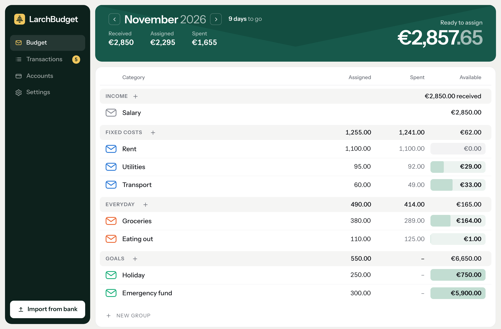
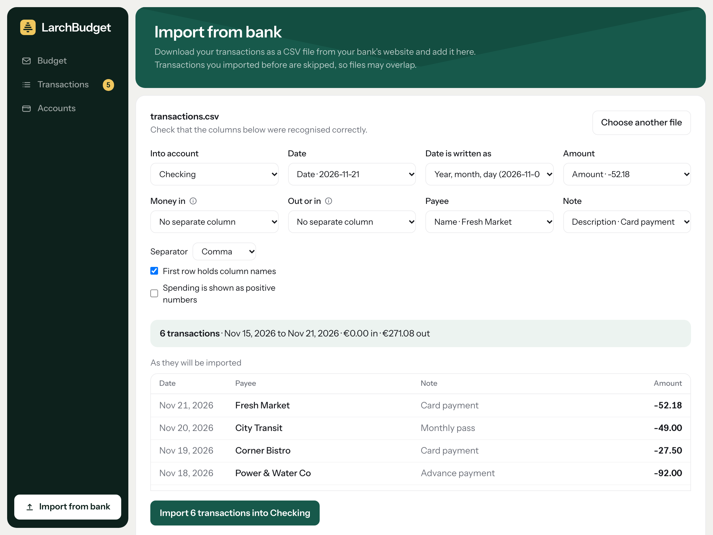
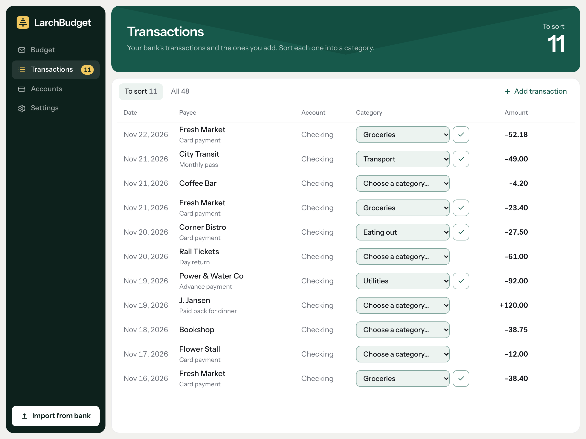
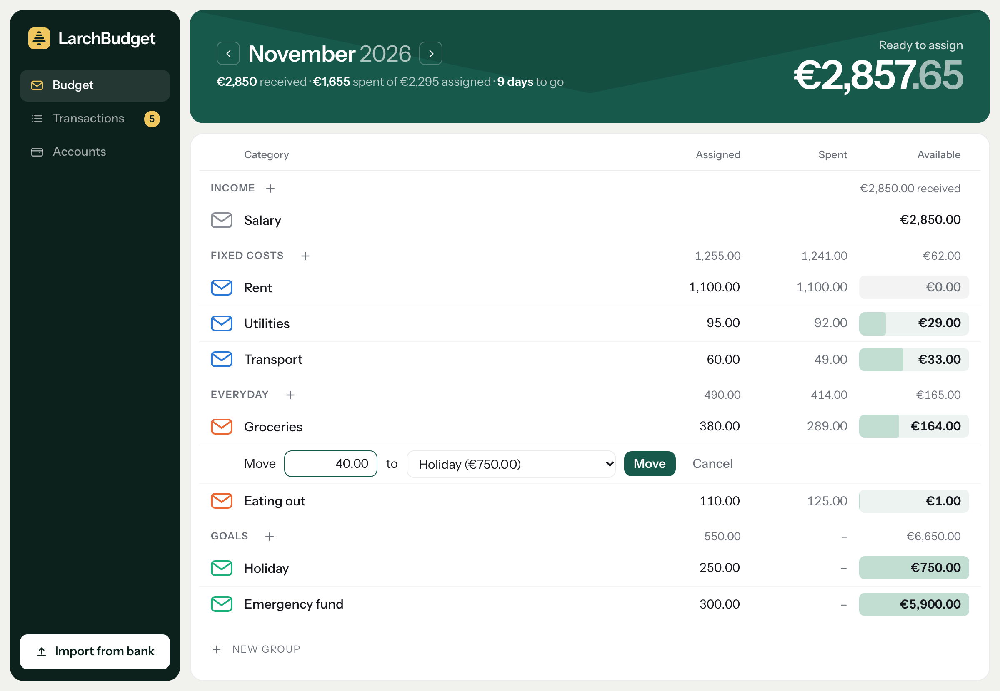

<p align="center">
  
</p>

<h1 align="center">LarchBudget</h1>

<p align="center">
  Simple budgeting for one person, on your own computer or server.
</p>

<p align="center">
  <a href="#get-started">Get started</a> ·
  <a href="docs/using.md">How it works</a> ·
  <a href="docs/installing.md">Installing</a> ·
  <a href="CONTRIBUTING.md">Contributing</a>
</p>

<p align="center">
  
</p>

LarchBudget does one thing: budgeting with the money you actually have. You
divide it over categories such as Rent, Groceries and Holiday, and your
spending comes out of them.

- **Every euro gets a purpose.** Money that is not in a category yet is
  _Ready to assign_, and stays in view until you have given it a place.
- **Your data stays with you.** Everything lives in one file on your own
  computer or server. LarchBudget is free and open source.
- **Simple to start.** One budget, a few screens, and little to learn before
  you can begin.

## A look inside

### Bring in your bank's transactions

Download a CSV file from your bank's website and drop it in. LarchBudget
recognises the columns, shows the transactions before anything is saved, and
skips the ones you imported before.



### Sort them in one go

Every transaction goes into a category. For a payee you have sorted before,
the category from last time is filled in already, and Enter accepts it.



### Move money when plans change

Groceries cost less than you thought, and the holiday more? Move money from
one category to another, or cover an overspent category from one that has
money left.



[Using LarchBudget](docs/using.md) explains every screen.

## Get started

You need [Docker](https://docs.docker.com/get-started/get-docker/). In a new
folder, download the file that tells Docker how to run LarchBudget:

```bash
curl -O https://raw.githubusercontent.com/m-ers/LarchBudget/main/docker-compose.yml
```

Then start it:

```bash
docker compose up -d
```

Open http://localhost:3000 and add your first account.

**Set a password before LarchBudget can be reached from outside your own
computer.** [Installing](docs/installing.md) explains how, and covers the
settings, backing up, updating and running without Docker.

To look around first, with demo data and without Docker, see
[Development](docs/development.md#run-it-locally).

## Documentation

- [Installing](docs/installing.md): Docker, settings, password, backing up
  and updating.
- [Using LarchBudget](docs/using.md): how the budget works, importing and
  sorting.
- [Development](docs/development.md): running it locally, how the code is
  organised and the rules it follows.
- [Contributing](CONTRIBUTING.md): what fits in LarchBudget and how changes
  get in.
- [Security](SECURITY.md): how to report a security problem.
- [Issues](https://github.com/m-ers/LarchBudget/issues): bugs, ideas and what
  is planned.

## License

[MIT](LICENSE)
