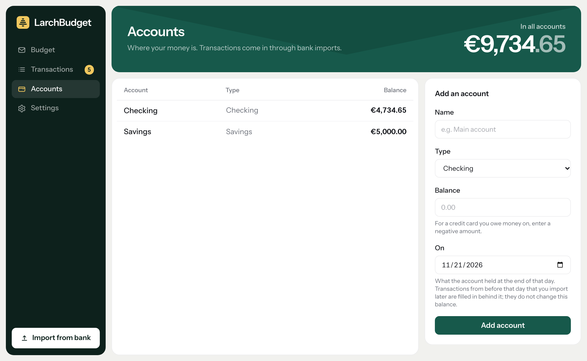
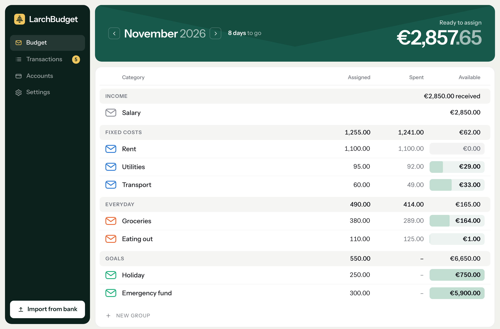
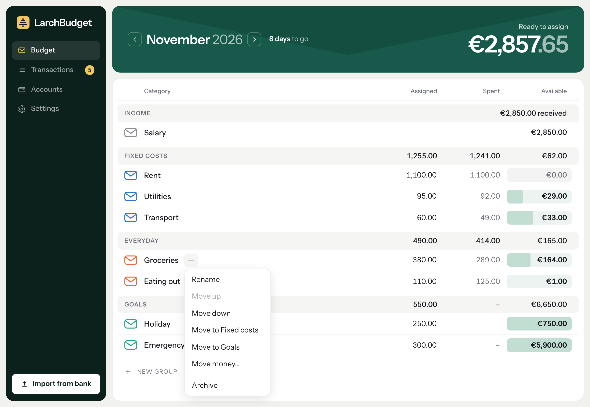
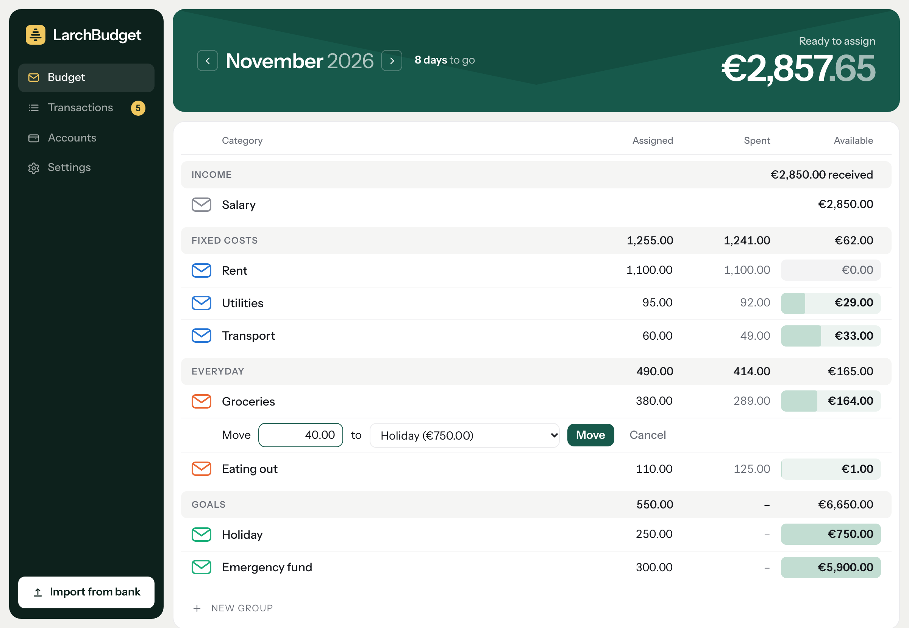
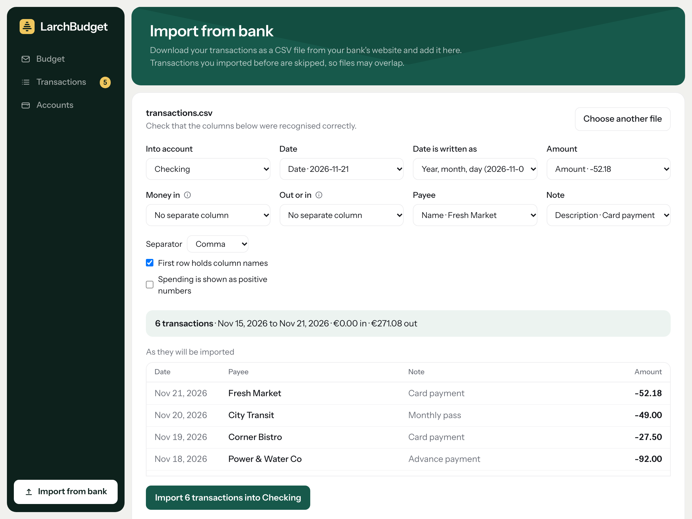
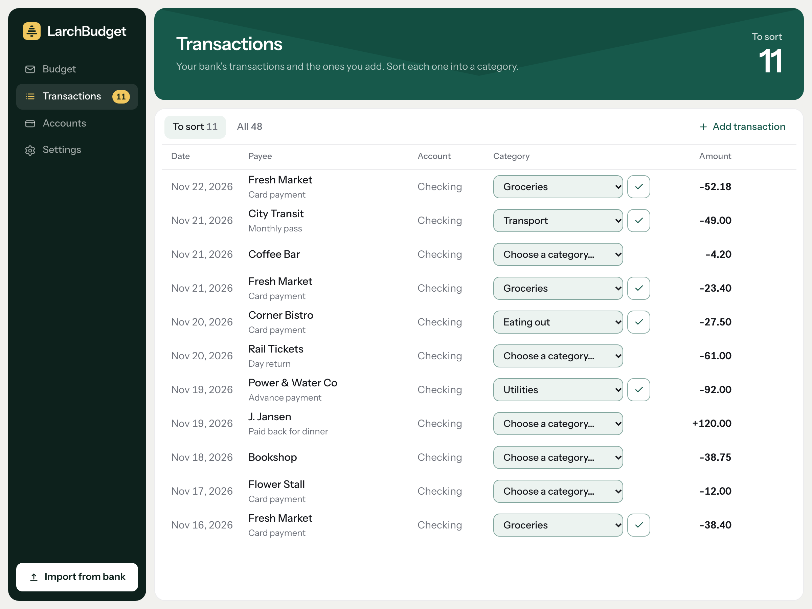

# Using LarchBudget

LarchBudget is for budgeting with the money you actually have, often called
envelope budgeting: you divide your money over categories, and spending comes
out of them. This page explains how that works and what every screen does.

- [The idea](#the-idea)
- [Start: accounts](#start-accounts)
- [The budget](#the-budget)
- [Income](#income)
- [Importing from your bank](#importing-from-your-bank)
- [Sorting transactions](#sorting-transactions)
- [Finding transactions](#finding-transactions)

## The idea

Think of each category as an envelope with money in it: one for Rent, one
for Groceries, one for Holiday. Four figures tell you where you stand.

- **Ready to assign** is money in your accounts that is not in a category
  yet. The aim is to bring it to zero: every euro has a purpose then.
- **Assigned** is what you put into a category this month.
- **Spent** is what was spent from the category this month. A refund lowers
  it.
- **Available** is what the category holds now. What is left at the end of
  the month stays in the category for the next month, and so does
  overspending.

One rule always holds: the money in your accounts equals Ready to assign plus
what is available in all categories. Nothing is counted twice and nothing
goes missing.

## Start: accounts

Add the accounts your money is in on the **Accounts** page: checking,
savings, cash or a credit card.

- Give each account the **balance** it held at the end of a day, usually
  today. That money becomes Ready to assign. For a credit card you owe money
  on, enter a negative amount.
- Transactions from before that day that you import later are filled in
  behind the balance; they do not change it.
- Click an account's name to rename it, and pick its type in its row. The
  buttons that show when you point at a row correct the balance, close the
  account or delete it.
- **Closing** is for an account you no longer use; it has to be empty first.
  Its transactions stay, and you can reopen it. **Deleting** an account
  removes its transactions too, and asks first.

## The budget

The **Budget** page shows one month. The arrows beside the month go to the
month before and after.

### Groups and categories

- **New group** at the bottom adds a group, such as Fixed costs, Everyday or
  Goals. The **+** beside a group's name adds a category to it. Enter adds
  the name and keeps the field open for the next one.
- Click a name to rename it.
- Point at a row and choose **⋯**, or right-click the row, for more: move it
  up or down, move it to another group, move money, or archive it.

- **Archiving** a category takes it off the budget and gives its money back
  to Ready to assign. Its transactions keep their category. Archived
  categories are listed at the bottom of the budget, where you can restore
  them.
- Deleting a group archives its categories.

### Assigning money

Type an amount in the **Assigned** column. Tab and the arrow keys go down and
up the column, so a whole month can be filled in from the keyboard.

- Click **Ready to assign** to see how it adds up: what was left over from
  the month before, plus what came in for this month, less what you assigned
  in it. Money without a category, amounts assigned in later months and
  money that is already in for a later month get a line of their own when
  there is any.
- Point at an **Available** amount to see how it adds up.
- The bar behind Available empties as you spend. It turns red when a category
  is overspent.
- When you assign more than you have, Ready to assign turns red and says so.
- In a month where nothing is assigned yet, one button assigns the same as
  the month before.
- A **Spent** amount is a link to the transactions behind it.

### Moving money

Plans change. **Move money…** in a category's menu moves an amount to another
category, or back to Ready to assign. For an overspent category the menu
offers **Cover overspending…**, with the amount filled in.

## Income

Income categories, such as Salary, sit above the groups. They hold no money:
what comes in through them is ready to assign. They show what came in each
month, and tell your salary apart from a refund or a transfer.

Paid near the end of the month, for the month after? Choose **Counts for the
next month** in the category's menu. Everything that comes in through it
during a month then shows as received in the month after: a salary paid on
25 October counts for November. An arrow after the name marks such a
category. Ready to assign does not change: the money can be assigned as soon
as it is there.

## Importing from your bank

Transactions come in through a CSV file that you download from your bank's
website.

1. Choose **Import from bank** and add the file.
2. LarchBudget recognises the columns (date, amount, payee, note) and shows
   the transactions as they will be imported. Correct a column if it guessed
   wrong. The **ⓘ** beside a label explains what it is for.
3. Choose **Import**. Transactions you imported before are skipped, so files
   may overlap.

Good to know:

- The column settings are remembered per account, so the next file from the
  same bank needs no setting up.
- Straight after an import, **Undo this import** takes it back. That stops
  being possible once you have sorted one of its transactions.
- A file can have up to 20,000 rows and be up to 4 MB. Split a larger file,
  for example by year.
- The file goes to your own LarchBudget server and nowhere else.

## Sorting transactions

Imported transactions wait on the **Transactions** page, under **To sort**,
until you have given each a category.

- Pick a category and the transaction is saved; the next one is ready at
  once.
- For a payee you have sorted before, the category from last time is filled
  in, in green. It is not saved yet: Enter or the check mark accepts it.
- Spending goes into the category it came out of. Income goes into an income
  category, such as Salary.
- A transfer between two of your own accounts gets **No category**: it
  leaves one account and arrives in the other, so your budget does not
  change.
- A transaction that is not sorted yet already counts: it lowers or raises
  Ready to assign until it has a category.

## Finding transactions

The **All** tab on the Transactions page lists every transaction, newest
first.

- Search by payee or note, or narrow the list by account, category or month.
  The line above the list says how many transactions match, with their money
  in and out.
- A transaction's category can be changed here at any time.
- The button that shows when you point at a row deletes the transaction. A
  deleted transaction does not come back when you import the same file
  again.
